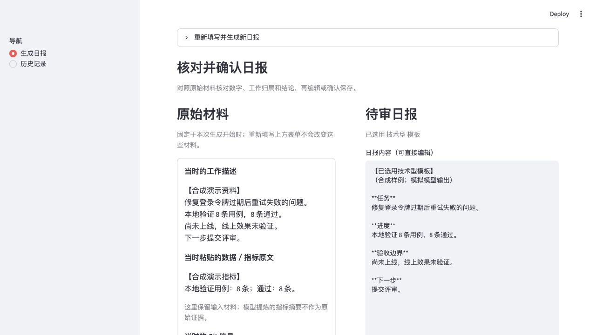

# WorkDiary Agent

Turn rough work notes into a daily report you can check, edit, and approve.

Keep the original notes, pasted metrics, and selected Git commits beside the draft. Correct the wording, request a revision, and save only when you are ready. Interrupted runs can resume from a local checkpoint.

[See the walkthrough](docs/demo.md) · [Run locally](#run-locally) · [Provider configuration](docs/configuration.md) · [Evidence and storage](docs/evidence-and-storage.md)



*Real Streamlit UI with synthetic notes and fixed offline model responses. This demonstrates the review workflow, not model quality. [Inputs, edits, recovery and saved output →](docs/demo.md)*

## From notes to a report you can stand behind

| You bring | WorkDiary prepares | You decide |
|---|---|---|
| Rough notes, pasted metrics, optional Git path and author | A frozen source snapshot and a technical, business, or mixed draft | Whether the facts, ownership, and conclusions match the evidence |
| A correction or missing detail | A revised draft, with up to three model revision rounds | Edit directly, request another revision, or explicitly approve |
| An unfinished run or saved report | Recoverable checkpoints, searchable history, and a Markdown export | Resume review, update a saved report, or confirm deletion |

For example, the walkthrough starts with **8 passing local checks and a fix that has not shipped**. The reviewer removes an unsupported impact claim and retains “not deployed; production impact unverified” in the [saved report](examples/review-walkthrough/approved-report.md).

## Run locally

Use Python 3.12 for the path below (package minimum: Python 3.10). Generating a new report requires a configured LLM provider; the screenshot walkthrough can be read without a key.

```bash
git clone https://github.com/xyma2003/workdiary-agent.git
cd workdiary-agent
python3.12 -m venv .venv
source .venv/bin/activate
python -m pip install -r requirements.txt
cp .env.example .env
```

Edit `.env`: the supplied example selects **SiliconFlow**. Replace `SILICONFLOW_API_KEY=sk-...` with your own key and select a model available to your account using `SILICONFLOW_MODEL`. Then run:

```bash
streamlit run app.py
```

Open **http://localhost:8501**. On Windows, activate with `.venv\Scripts\Activate.ps1` in PowerShell. For official OpenAI, another compatible endpoint, Anthropic, proxy settings, or a durable data directory, follow [configuration](docs/configuration.md); use one provider configuration at a time. Existing shell variables take precedence over `.env`.

## Use it

1. Enter your work notes. Optionally add raw metrics, a Git repository path, and an author identity; choose a template or let the router select one.
2. Click **生成日报**. Generation pauses at **核对并确认日报** with the frozen sources beside the draft.
3. Edit **日报内容（可直接编辑）**, or request a revision. Check the original material before accepting a factual warning. Suspected credentials must be removed.
4. Click **接受** to save the report to local history and export Markdown. History supports search, filters, pagination, edits, and confirmed deletion.
5. For an interrupted run, open **恢复未完成日报** and resume the checkpoint. An editor change alone is not a saved checkpoint: submit the revision or accept the report before expecting that edit to persist.

The [walkthrough](docs/demo.md) follows these steps in the actual application, including a restart during review and comparison with the saved source snapshot.

## What the evidence can tell you

- Sources are frozen before model work. Later repository changes or edits to the new-report form do not replace that evidence.
- A model's metric summary is labeled **非原始证据**. Number and time-unit checks are warnings, not proof that a report is factually correct; final approval stays with you.
- A snapshot records selected commit subjects and client configuration, not a repository backup or proof of the exact model revision served. Older records without snapshots remain explicitly unknown.
- Notes, pasted metrics, and selected Git subjects go to your configured provider. Redaction is best-effort; only provide material that provider is allowed to process.
- History, checkpoints, and exports are local files. Keep the app local unless you add access controls. A deletion can leave a failed export cleanup task; the UI reports it and offers a retry.

Details: [review, privacy and storage boundaries](docs/evidence-and-storage.md).

## Maintenance and contributions

- **Current status:** A local report-writing application with source snapshots, explicit review, checkpoint recovery, and offline regression checks. The walkthrough demonstrates the workflow with fixed responses; it does not validate model quality.
- **Time-unit review:** A change from “10 ms” in the frozen sources to “10 s” in the report now produces a review warning. Equivalent aliases such as “10 毫秒” and “10 milliseconds” are accepted. Supported units and limits are described in [review checks](docs/evidence-and-storage.md#review-against-the-original-material).
- **Known limitation:** Checks do not align individual metrics, convert units, or verify direction and causality. A number/unit pair found anywhere in the sources may belong to another metric; other quantities and unsupported time notation still need manual review.
- **Contributing to these checks:** Add a minimal original-source/report example and an expected warning to [the quality tests](tests/test_quality.py). Keep the scope and unsupported cases explicit, and run `python -m pytest tests/test_quality.py -q`; it needs no model calls.

For a bug report, [open an issue](https://github.com/xyma2003/workdiary-agent/issues/new) with the repository commit, OS/Python version, provider mode if relevant, minimal reproduction steps, and expected versus actual behavior. Use synthetic notes and redacted logs; do not attach keys, `.env`, private work notes, or history databases. A focused PR should explain the change, checks actually run, and remaining limits.

## Development and checks

```bash
# Offline checks: no model calls or API key required
python -m pip install -e '.[dev]'
python -m pytest tests/ -m "not integration" -v
```

The graph, review/resume paths, source snapshots, storage, and Streamlit interactions have offline regression checks. Current results are in [Actions](https://github.com/xyma2003/workdiary-agent/actions/workflows/test.yml).

Live provider tests and the router benchmark make model calls and may incur costs. Export provider variables into your shell before running the integration tests; those tests do not load `.env` themselves. The router script does load `.env`:

```bash
python -m pytest tests/ -m integration -v
python scripts/evaluate_router.py --limit 3
```

The routing dataset has 30 balanced cases across three templates. No accuracy score is claimed without a run tied to a specific provider/model and reviewed labels. The walkthrough uses fixed responses and is not that evaluation.

## Inside the project

Built with LangGraph, Pydantic, Streamlit, GitPython, and separate SQLite stores for graph checkpoints and report history. An explicit review interrupt separates drafting from saving; source snapshots survive report edits.

[Workflow and architecture](docs/architecture.md) · [Source code](workdiary_agent/) · [Dependency versions](pyproject.toml) · [MIT license](LICENSE)
