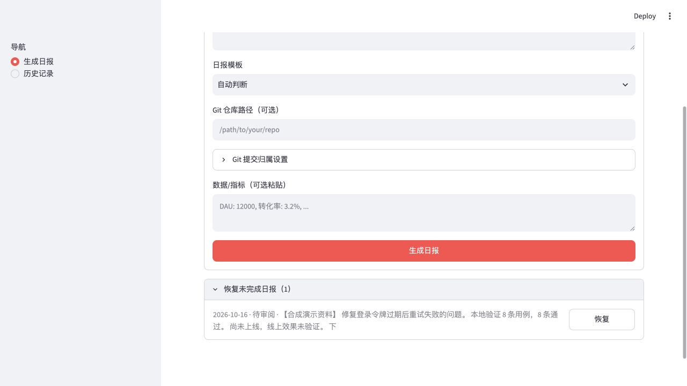
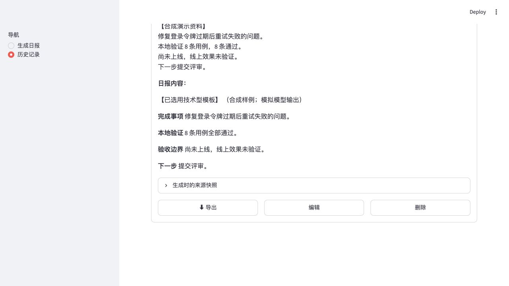

# A report you can review, revise and recover

[Back to README](../README.md) · [Exact scenario](../examples/review-walkthrough/scenario.json) · [Actual saved Markdown](../examples/review-walkthrough/approved-report.md)

Recorded on **2026-10-16**, using the real Streamlit app and graph at application commit [`ba1e464`](https://github.com/xyma2003/workdiary-agent/commit/ba1e464fa9440f970afca498594da12823b3c252). The accompanying documentation update does not change application code.

The work notes and model replies are **synthetic fixtures**. A temporary wrapper replaced the model client with fixed responses, blocked external requests, and used an isolated data directory. Every visible form, review control, checkpoint, history entry and export came from the application. No real provider was called and no personal work records were used. This is a workflow demonstration, not a model-quality evaluation or a built-in no-key generation mode.

## 1. Enter the evidence

Choose **技术型** and paste these notes:

```text
【合成演示资料】
修复登录令牌过期后重试失败的问题。
本地验证 8 条用例，8 条通过。
尚未上线，线上效果未验证。
下一步提交评审。
```

The metrics field contains `【合成演示指标】本地验证用例：8 条；通过：8 条。` The Git path is left empty for this walkthrough; it does not demonstrate commit collection. Click **生成日报**.

## 2. Correct an unsupported claim

The deliberately flawed fixed draft adds **“登录成功率提升 20%。”** The source has no production measurement. The UI flags the number `20` as absent from the source and blocks acceptance until the warning is handled. This check only compares numbers; it cannot establish factual correctness.

In **日报内容（可直接编辑）**, remove that sentence and add:

```text
**验收边界**
尚未上线，线上效果未验证。
```


Click **↻ 重新生成**, enter **“删除无依据的提升结论，保留本地验收结果和未上线边界。”**, then click **确认修改**. The recording fixture verifies that both the edited text and feedback actually reach the revision step before returning its revised response. The exact initial, edited and revised texts are preserved in [scenario.json](../examples/review-walkthrough/scenario.json).

**Persistence boundary:** typing in the editor alone does not checkpoint that edit. Here the revision was submitted and completed before restarting. Accepting the report also submits the edited text for saving.

## 3. Restart and resume the same review

Stop the Streamlit process, restart with the **same data directory**, and reload the browser. Open **恢复未完成日报（1）** and click **恢复**.



The restored draft contains the completed revision, including “尚未上线，线上效果未验证。” The original notes and metrics are unchanged. The recording checked the checkpoint before and after restart: the source snapshot and revised text matched exactly. The mock-client call count stayed at five; reopening the review made no additional model calls.

## 4. Accept, inspect history and export

Click **✓ 接受**, then open **历史记录 → 2026-10-16 — 技术型**. Expand **生成时的来源快照** to compare the saved report against the same original material.



The run produced one history record and one Markdown export. Its body equals the revised text; the export adds the normal `# 日报 2026-10-16` heading. The [included report](../examples/review-walkthrough/approved-report.md) is copied from that actual export. The completed run no longer appears as recoverable.

## Try the workflow yourself

Follow [Run locally](../README.md#run-locally), configure a provider and use the notes above. Real responses will differ from these fixed fixtures and may incur provider costs. Review every claim yourself. For deterministic offline regression checks, run `python -m pytest tests/ -m "not integration"` after installing the development dependencies with `python -m pip install -e '.[dev]'`.

The acceptance run passed **122 offline tests, with 6 integration tests deselected**. Those checks and this recording do not validate live-provider availability, writing quality or production impact. See [evidence and storage boundaries](evidence-and-storage.md).
